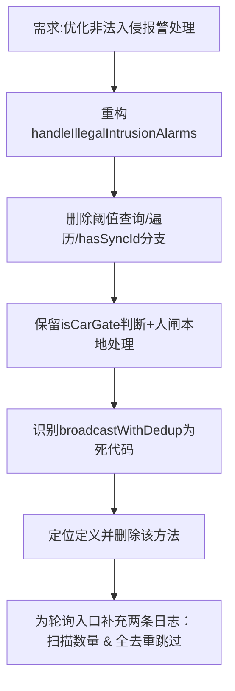

## 任务描述
重构非法入侵报警（alarm_type=4）处理逻辑，精简冗余DB查询与分支，清理未调用的broadcastWithDedup方法，并为@Scheduled轮询任务补充关键日志以提升可观测性。

## 执行过程

## 任务总结
实现报警处理轻量化：将原40行逻辑压缩至15行，删除50行冗余代码（含19行死方法），新增2行关键日志，形成完整轮询可观测链路（扫描→去重决策→播报），明确车闸必须有syncId的业务约束。
