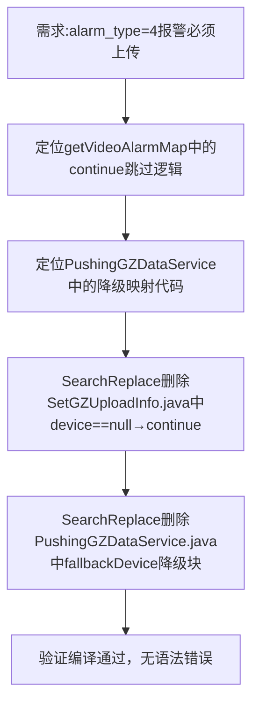

## 任务描述
修复视频报警数据上传逻辑：对 alarm_type=4（非法入侵）等无法关联视频设备的报警，禁止跳过或降级，改为设备字段置空后正常上传。

## 执行过程

## 任务总结
成功实现非设备关联型报警的直传策略：在 getVideoAlarmMap 中移除 device == null 时的 continue，改为空字符串填充 place_no/video_code/camera_name；同步删除 PushingGZDataService 中的降级映射逻辑，确保 alarm_type=4 报警完整上传且设备字段为空。
