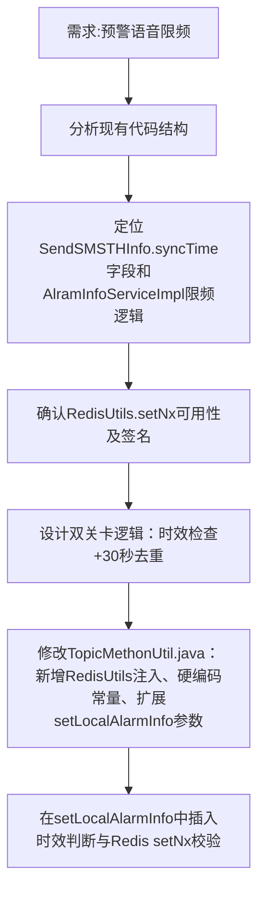

## 任务描述
为预警语音播报功能增加双重限频控制：① 数据同步时间距当前超过80秒则跳过播报；② 同一企业30秒内只播报一次（Redis setNx原子去重）。

## 执行过程

## 任务总结
成功实现预警语音播报限频：在TopicMethonUtil.java中新增WARNING_MAX_AGE_SECONDS=80和VOICE_RATE_LIMIT_SECONDS=30两个静态常量，扩展setLocalAlarmInfo方法接收syncTime参数，并在其内部按顺序执行时效检查（now-syncTime>80s则return）和Redis setNx去重（key=alarm:voice:ratelimit:{companyCode}），确保80秒窗口内最多播报2次且严格按30秒间隔。
