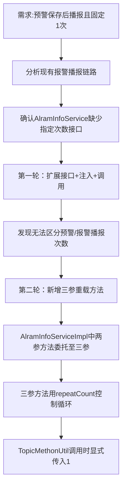

## 任务描述
为预警信息推送（EarlyWarningInfoPushRecord）增加丹唛派克语音播报能力，并确保预警播报固定为1次，区别于报警的可配置重复次数。

## 执行过程

## 任务总结
成功实现预警语音播报差异化控制：在AlramInfoService新增三参重载方法，AlramInfoServiceImpl统一委托并用参数驱动播报次数，TopicMethonUtil调用时传入1，确保预警仅播报1次，报警仍沿用voiceRepeatCount配置。
