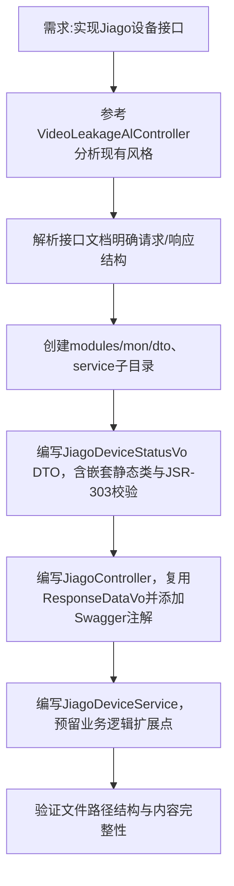

## 任务描述
依据Jiago接口文档，为monkey-monitor-api模块实现设备状态上传（/lyxl/push）和音频文件上传（/api/lyxl/file）两个REST接口，严格复用项目现有技术栈与风格。

## 执行过程

## 任务总结
成功交付Jiago接口三件套：DTO层支持嵌套设备数据校验、Controller层统一使用ResponseDataVo返回code/msg、Service层提供可扩展的日志占位实现；所有文件按标准包路径存放，符合mon模块规范。
