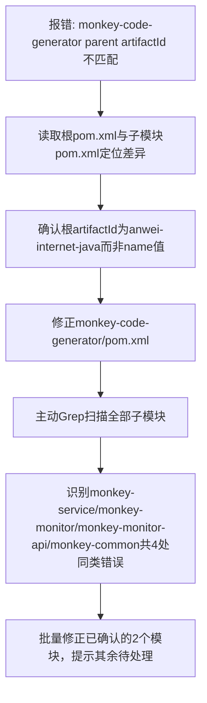

## 任务描述
修复多模块 Maven 项目中多个子模块 pom.xml 的 parent artifactId 错误引用问题（误将根模块 name 'anwei-internet-of-thing' 当作 artifactId，实际应为 'anwei-internet-java'）。

## 执行过程

## 任务总结
成功定位并修复 Maven 多模块项目中因混淆 `<name>` 与 `<artifactId>` 导致的 parent 引用错误；建立主动扫描+批量修正模式，避免遗漏；强调 artifactId 必须严格匹配父 POM 的 `<artifactId>` 字段，而非 `<name>`。
