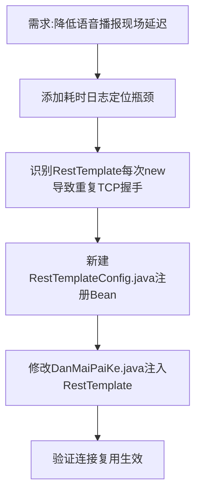

## 任务描述
优化语音播报链路中因频繁新建RestTemplate导致的TCP握手延迟问题，通过Spring Bean化RestTemplate并复用连接池降低现场播报延迟。

## 执行过程

## 任务总结
成功将RestTemplate改造为Spring管理的单例Bean：新增RestTemplateConfig配置类（含5s超时与SimpleClientHttpRequestFactory），修改DanMaiPaiKe构造函数注入，消除每次播报重建HTTP连接的开销，预计节省200-400ms延迟。
