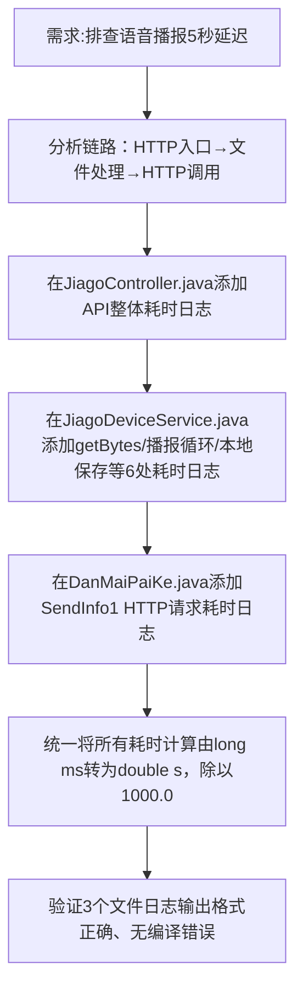

## 任务描述
为语音播报链路添加全链路耗时日志，定位现场5秒延迟原因，并统一日志时间单位为秒（s）。

## 执行过程

## 任务总结
成功实现端到端耗时追踪：在Controller层记录API总耗时，在Service层细粒度记录file.getBytes、5次播报调用、播报总耗时、本地保存及方法总耗时，在DanMaiPaiKe层记录单次HTTP请求耗时；全部日志前缀统一为[耗时追踪]，单位统一为秒（保留小数），便于快速定位瓶颈（如多次HTTP调用累积延迟）。
