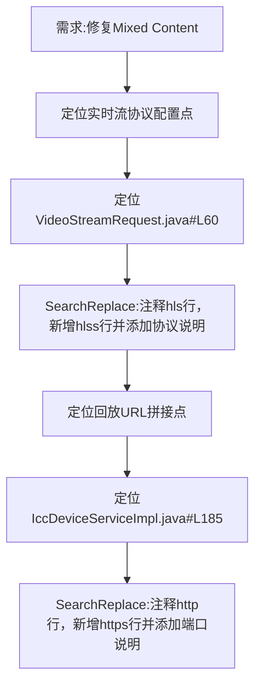

## 任务描述
解决前端HTTPS页面加载HTTP流导致的Mixed Content错误，将ICC实时流与回放流统一升级为HTTPS协议（hlss/7096）。

## 执行过程

## 任务总结
成功完成流协议HTTPS化改造：在VideoStreamRequest中将data.setType("hls")替换为"hlss"并保留原注释；在IccDeviceServiceImpl中将host拼接从"http://...:7086"改为"https://...:7096"，同步添加清晰注释说明协议与端口变更，确保可追溯。
