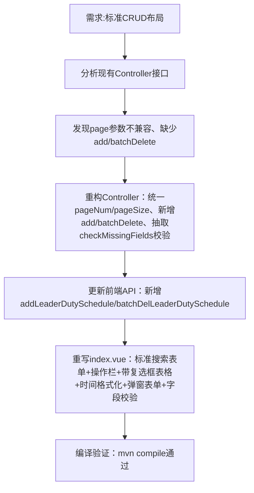

## 任务描述
为 leaderDutySchedule 模块实现标准 RuoYi 增删改查功能，包括顶部搜索区、新增/批量删除按钮、表格列表（含修改/删除操作列）、分页及弹窗表单。

## 执行过程

## 任务总结
成功将 leaderDutySchedule 改造为标准 CRUD 模块：后端支持分页查询（pageNum/pageSize）、单条新增、批量删除、带字段校验的修改；前端 API 新增对应函数；Vue 页面完全重写，对齐 contractor/check 等已有模块风格，支持搜索、勾选、弹窗、时间解析与手机号校验。
