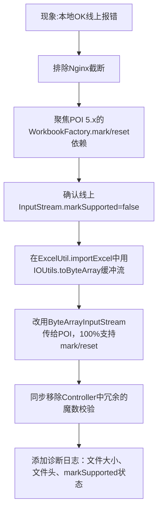

## 任务描述
解决同一Excel文件（16KB）本地可导入、线上报错的问题，根因是线上Servlet容器返回的InputStream不支持mark/reset，导致POI 5.x无法识别文件类型。

## 执行过程

## 任务总结
成功修复Excel导入环境差异问题：在ExcelUtil中强制将原始InputStream读入byte[]并转为ByteArrayInputStream，彻底绕过原始流兼容性问题；同时精简Controller逻辑，增加关键诊断日志，使后续同类问题可直接通过日志定位根因。
