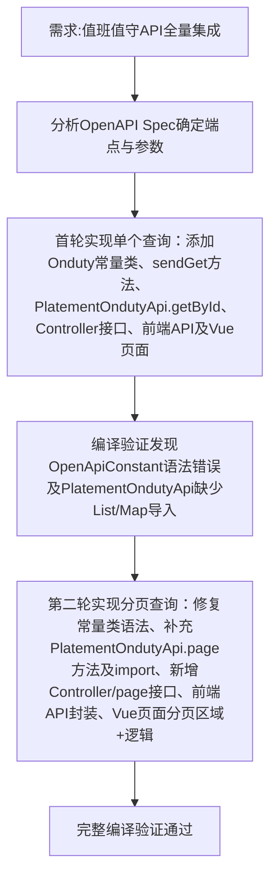

## 任务描述
完成值班值守模块全量OpenAPI集成，覆盖5.2.4.4单个查询与5.2.4.5分页查询功能，实现从前端页面到后端服务再到平台API调用的完整链路。

## 执行过程

## 任务总结
成功集成值班值守全部5个OpenAPI：新增Onduty常量类并修复语法；在PlatementBaseApi补充sendGet；在PlatementOndutyApi实现getById/page；Controller提供/get/{id}和/page接口；前端完成API封装与index.vue双模式查询（单个ID输入+多条件分页表格）。
