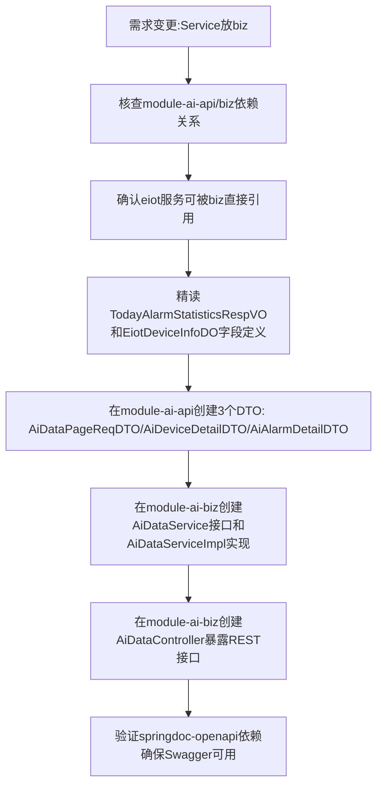

## 任务描述
为AI服务提供设备与告警数据接口，明确要求Service接口和实现均放在module-ai-biz中，module-ai-api仅保留DTO，Python AI通过HTTP调用Controller。

## 执行过程

## 任务总结
成功构建面向AI的数据服务层：严格遵循“api仅DTO、biz含Service+Controller”架构，DTO精准映射eiot业务VO/DO字段，ServiceImpl通过依赖注入调用fireDashboardService/fireAlarmOrderService/eiotDeviceInfoMapper，Controller统一返回CommonResult<data>格式，完全满足外部AI服务HTTP调用需求。
