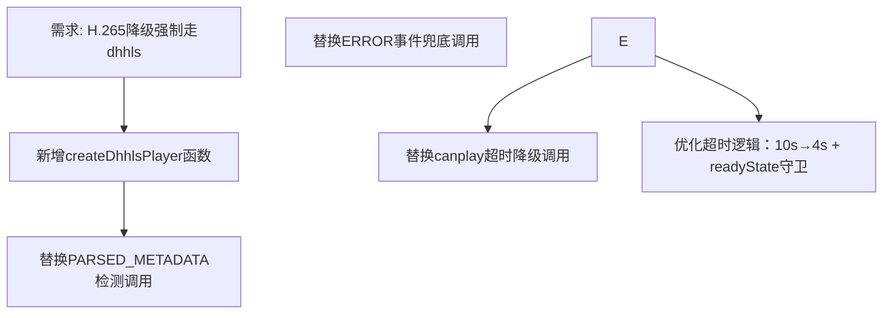

## 任务描述
统一H.265编码摄像头的降级策略，强制跳过原生HLS路径，全部直接使用dhhls播放器。

## 执行过程

## 任务总结
完成H.265降级路径全面dhhls化：新增健壮的createDhhlsPlayer函数（含HTTPS校验、加载失败提示、错误分类处理），并将三层降级入口（metadata解析、ERROR事件、canplay超时）全部指向该函数；进一步将超时阈值从10秒压缩至4秒，并加入video.readyState > 0守卫，避免H.264正常流误触发。

## 备注
- 本条的降级方案已被后续实测推翻，仅作历史快照保留：dhhls 与 dhflv 同属 MSE 体系，只能解码浏览器自身解码器支持的编码，摄像头主码流为 H.265 时 dhhls 依旧报 bufferAddCodecError，"三层降级最终落到 dhhls"在原理上就解不出画面，因此这条链路不能修复 H.265 拉流失败。最新权威口径见记忆"HLS/FLV拉流失败的三层结构性根因与降级无效陷阱"与"视频播放技术栈：WSPlayer 与 MSE 系双方案及适用边界"：PC 端遇 H.265/MSE 解码失败应整包换 WsPlayerWrapper.vue（RTSP over WS + WASM 软解，照抄 AlarmVideoDialog.vue 改法，后端零改动），不要再继续调 HLS 分片/缓冲或更换 MSE 播放器；移动端小程序无 WASM 环境只能 HLS，切入口是上游保活预热。
