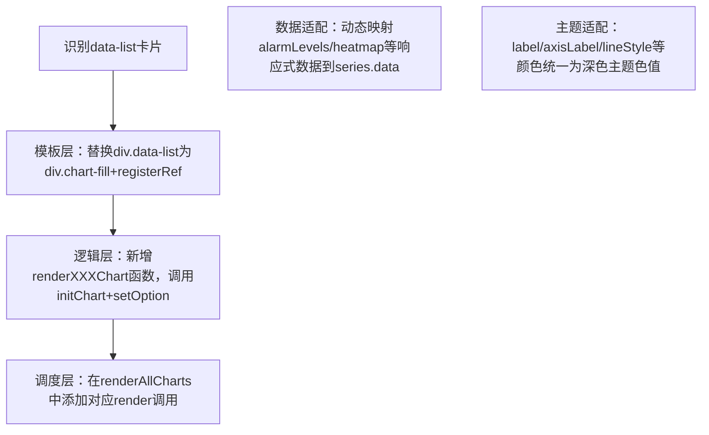

## 任务描述
将 Vue 组件中多个 data-list 类型的静态卡片（如告警等级分布、24h告警时段分布）统一替换为响应式 ECharts 图表，实现可视化升级。

## 执行过程

## 任务总结
建立标准化图表改造流程：1）模板注册 ref（如 'alarmLevel'/'heatmap'）；2）独立 render 函数封装 ECharts 初始化与 option 配置；3）统一纳入 renderAllCharts 调度；4）数据驱动（alarmLevels.value.map）、深色主题配色（如 rgba(139,157,197,0.8)）和动画效果（elasticOut/scale）全部适配完成。

## Notes
- 本流程记录的是历史阶段的改造快照，后续已被推翻：该批图表因 Vue 3 slot 作用域导致容器宽高为 0（'Can't get DOM width or height'）曾整体移除 ECharts 改回数据列表（见"数据中心图表渲染失败的根本解决"）。
- 最新有效结论（数据中心重规划轮）：重新引入 ECharts 时不再套用 registerRef/initChart/renderAllCharts 模板，改为抽 useChart composable 收口实例生命周期（resize 监听配对解绑、activated 统一 resize、onUnmounted dispose），图表容器一律用行内 style 并沿 flex 链每层补 min-width:0 + min-height:0，loading 仅首屏以避免 slot DOM 重建竞态。复用本记忆前先确认目标页面当前是否处于列表形态。
