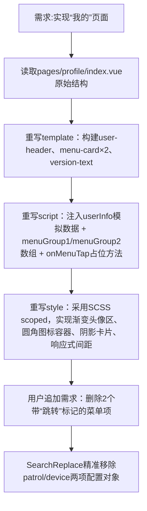

## 任务描述
实现移动端“我的”页面UI，严格对照设计稿，支持顶部用户信息展示、两组菜单卡片（含角标/附加文字）、版本信息及底部TabBar，并支持后续菜单项动态删减。

## 执行过程

## 任务总结
成功交付高保真“我的”页面：深蓝渐变用户头像区、8+4结构菜单卡片（含角标与附加文案）、uni-icons统一图标体系、SCSS模块化样式；所有菜单点击有toast反馈；支持通过修改data数组灵活增删菜单项。
