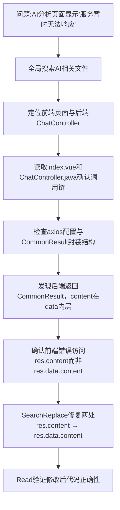

## 任务描述
定位并修复智能分析页面（ai-analysis/index.vue 和 ai/chat/index.vue）无法调用AI服务的问题。

## 执行过程

## 任务总结
根因是前端未适配后端CommonResult统一响应包装，错误访问顶层res.content（实际为undefined），导致始终进入失败分支。通过精准修改两处判断逻辑为res.data && res.data.content，使AI响应内容可被正确提取、过滤并渲染，问题彻底解决。

## Notes
- 【字段访问层级需先确认请求通道（2016-10 会话复核）】"必须写成 res.data.content"不是普适结论：本仓库前端有两条通道——走 src/config/axios 的 request 封装时拦截器已剥掉 CommonResult 外层，返回值就是 data 本体，此时应直接访问 res.content / res.xxx（本轮新增的 AI 告警研判接口即按此写法并通过 vue-tsc 校验）；只有绕过封装、用原生 axios 或手写 fetch 拿到原始响应体时才需要 res.data.content。改这类页面前先读该文件实际的 import 来源与封装实现再定层级，勿照搬本条结论批量替换，否则会把已正常的调用改坏。
