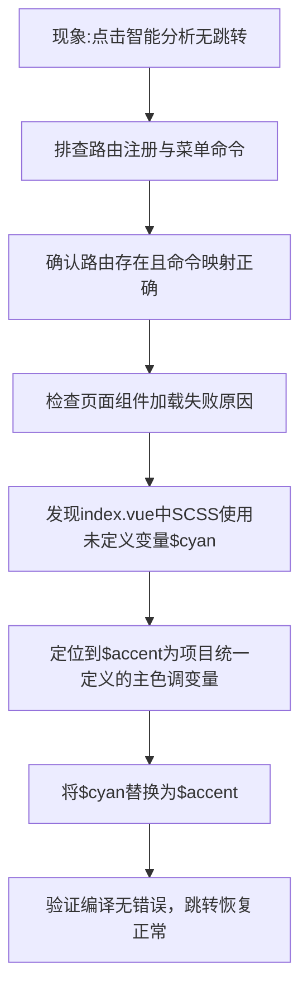

## 任务描述
解决AI分析页面（/eiot/firewatch/ai-analysis）点击菜单后无响应的问题，根因为SCSS中使用了未定义变量$cyan，导致组件编译失败、无法渲染。

## 执行过程

## 任务总结
成功修复AI分析页面跳转失效问题：根本原因是index.vue中SCSS使用了未声明的$cyan变量，将其统一替换为项目已定义的$accent变量后，组件可正常编译加载，路由跳转功能恢复。
