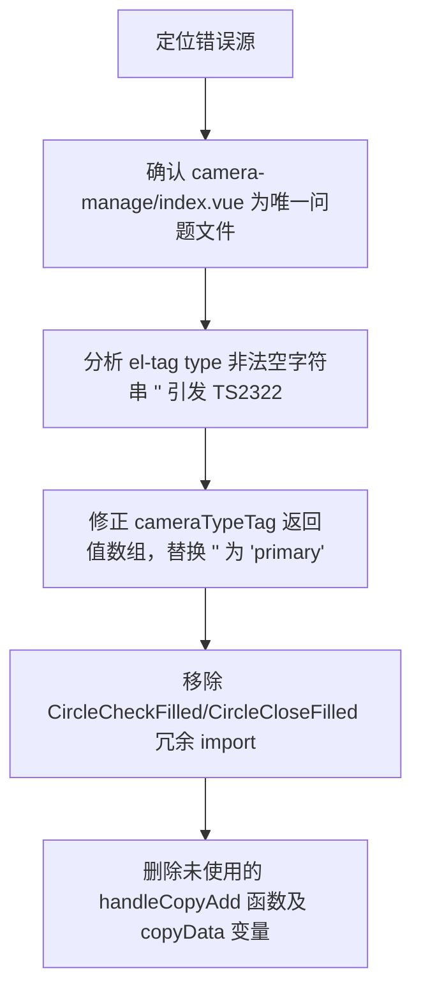

## 任务描述
修复 camera-manage/index.vue 中的 TypeScript 类型错误（TS2322）和未使用声明警告（TS6133）。

## 执行过程

## 任务总结
成功修复所有 TS 错误：el-tag type 严格限定为 Element Plus 支持的字面量（'success'|'warning'|'info'|'primary'|'danger'）；动态组件字符串引用无需显式 import 图标；彻底清理未使用代码避免 TS6133。
