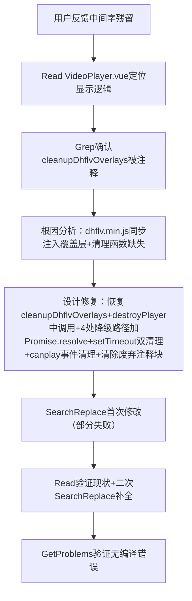

## 任务描述
修复 VideoPlayer.vue 中 H.265 降级后残留 'FLV暂不支持H265视频播放' 覆盖层文字的问题。

## 执行过程

## 任务总结
成功解决覆盖层残留：恢复 cleanupDhflvOverlays 函数（精准移除非白名单子元素），在 destroyPlayer、4个H.265降级触发点（interceptH265/PARSED_METADATA/ERROR/startFallbackTimer）及 canplay 事件中均加入清理调用，并采用 Promise.resolve() + setTimeout(200ms) 双保险机制应对 dhflv 同步注入特性。
