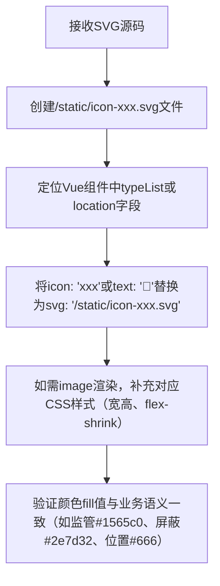

## 任务描述
将告警类型分布（监管、屏蔽）和告警中心位置图标，从旧有 iconfont/emoji 替换为自定义 SVG 图标，实现矢量、可配色、高一致性显示。

## 执行过程

## 任务总结
完成三处 SVG 替换：监管/屏蔽图标在 index.vue typeList 中由 icon 字段改为 svg 字段；位置图标在 alarm-center/index.vue 中由 emoji 改为 image 标签引用，并新增 .info-svg 样式确保尺寸与对齐。关键原则：SVG fill 值需匹配业务色值，路径统一用 /static/，Vue 中优先用 svg 字段（若无则增 image + class）。
