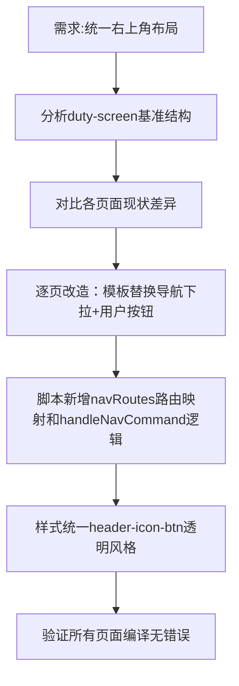

## 任务描述
将所有大屏页面（device-screen、data-center、video-surveillance、ai-analysis、ops-workbench、remote-console、large-screen、monitoring-center、alarm-screen）的右上角按钮布局统一为/duty-screen的标准结构：Grid导航下拉菜单（含全部页面入口）、Setting按钮、全屏按钮、用户按钮（动态昵称）。

## 执行过程

## 任务总结
成功实现9个页面右上角统一：所有页面均采用Grid导航下拉菜单（含8个标准入口）、Setting按钮、全屏按钮和动态用户按钮；脚本层通过useUserStore获取昵称，navRoutes统一管理路由映射；样式层全面应用header-icon-btn透明无边框规范，确保视觉与交互一致性。
