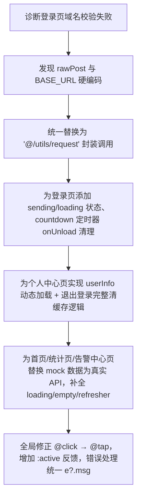

## 任务描述
对微信小程序多个核心页面（登录页、首页、个人中心、统计页、告警中心）进行健壮性统一改造，解决硬编码、无状态反馈、内存泄漏、mock 数据未替换、API 调用不规范等问题。

## 执行过程

## 任务总结
完成小程序多页面健壮性升级：统一请求入口、消除硬编码、完善状态管理（loading/sending/timer）、修复内存泄漏、动态加载用户信息、实现安全退出、补全空/加载/刷新交互，显著提升生产可用性。
