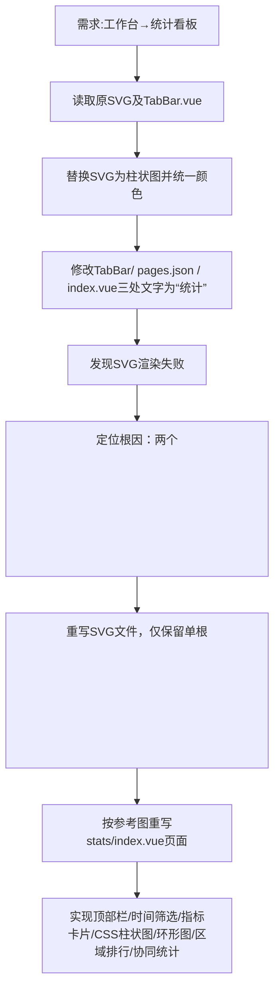

## 任务描述
将工作台功能整体升级为统计看板，包括：1）图标由四宫格改为三柱状图SVG；2）所有界面文字统一为“统计”；3）修复SVG双根节点导致图标不显示问题；4）重写stats/index.vue实现完整数据统计UI。

## 执行过程

## 任务总结
成功完成工作台到统计看板的全面改造：1）图标使用单根<svg>柱状图（灰色/红色）；2）全链路文字统一为“统计”；3）stats/index.vue采用纯CSS实现响应式统计UI（含conic-gradient环形图、flex柱状图、进度条），零第三方依赖。
