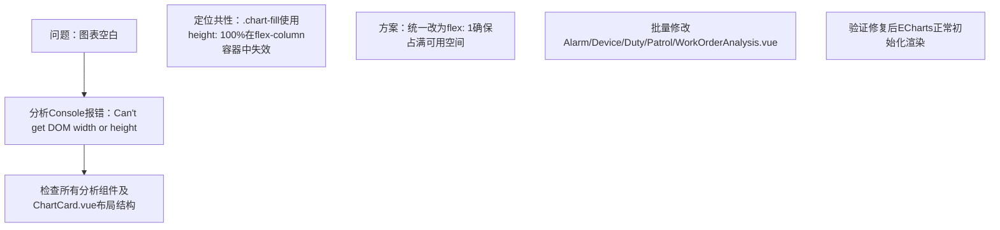

## 任务描述
解决数据中心各分析图表（巡检/告警/设备/值班/工单）不显示的问题，根因为ECharts初始化时容器宽高为0。

## 执行过程

## 任务总结
根本原因是flex布局下`height: 100%`无法正确计算高度，导致ECharts获取到0尺寸容器。通过将5个分析组件中`.chart-fill`的`height: 100%`统一替换为`flex: 1`，彻底解决图表不显示问题，修复后ECharts可正常获取容器尺寸并渲染。

## Notes
- 本记忆原方案（仅把 height:100% 改 flex:1）不充分：数据中心重规划轮经用户评审指出，flex 链上只要有一层未设 min-width:0，width:100% 仍会被撑爆或缩成 0——这正是当年进一步移除 ECharts 的根因之一。
- 最新完整规避口径：沿父容器链每一层同时补 min-width:0 + min-height:0；图表容器一律用行内 style（绕开 scoped 样式穿透/:slotted() 失效问题）；初始化链固定 onMounted → nextTick → echarts.init → setOption；极端情况退路是给容器直接固定像素 height。仅靠 flex:1 单一改动不足以根治。
