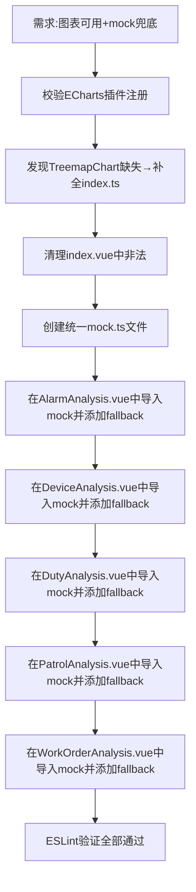

## 任务描述
为数据中心模块完善 ECharts 图表支持并实现 API 空数据时的 mock 兜底机制。

## 执行过程

## 任务总结
成功构建数据中心 mock 体系：1）修复 ECharts Treemap 注册缺失与模板非法 script 标签；2）创建结构化 mock.ts（覆盖告警/设备/值班/巡检/工单5大维度）；3）5个分析组件均实现 'API返回空则自动切换mock' 的健壮 fallback 逻辑；4）零 ESLint 错误。
