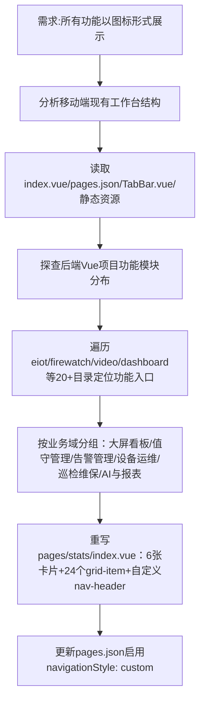

## 任务描述
为消防远程值守系统构建图标化工作台页面，将全部24个功能按业务域分类，以4列网格形式展示在6张卡片中，并适配自定义顶部导航。

## 执行过程

## 任务总结
成功落地图标化工作台：pages/stats/index.vue完全重写，实现6大业务域共24个功能图标入口，统一采用88rpx圆角图标+22rpx文字标签+4列网格布局；pages.json同步配置custom导航栏，隐藏原生标题栏，视觉风格与参考图严格对齐。
