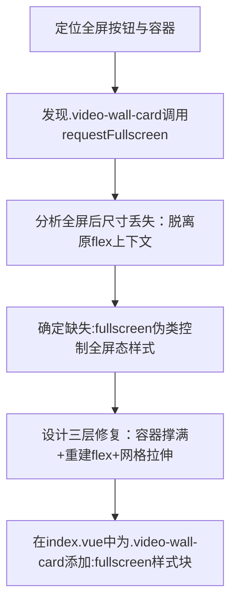

## 任务描述
解决监控墙全屏后视频画面不随屏幕尺寸自适应的问题。

## 执行过程

## 任务总结
通过为.video-wall-card添加:fullscreen伪类，设置width:100%;height:100vh;display:flex;flex-direction:column，并确保.wall-grid和.wall-cell继承flex:1/min-height:0，使全屏后视频网格及内部video-element能正确拉伸填满视口。
