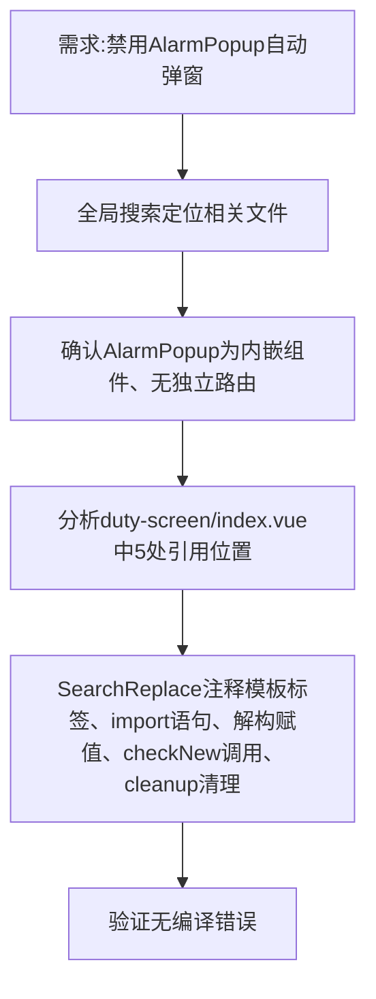

## 任务描述
前端远程值守大屏中，临时禁用 AlarmPopup 自动弹窗组件（8秒倒计时告警提示），保留 AlarmPopupPage 详情弹窗功能。

## 执行过程

## 任务总结
成功注释 duty-screen/index.vue 中 AlarmPopup 全链路：模板、导入、逻辑解构、触发调用、卸载清理共5处，实现零侵入式临时禁用，不影响 AlarmPopupPage 详情弹窗及其他功能。
