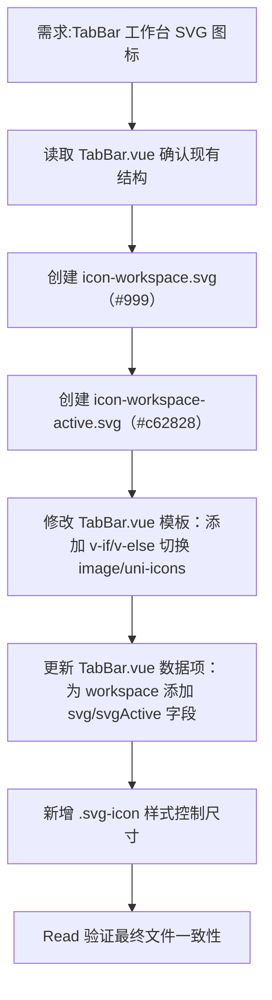

## 任务描述
为移动端 TabBar 的‘工作台’Tab 替换为四宫格 SVG 图标，支持非激活（灰色 #999）与激活（红色 #c62828）双状态自动切换。

## 执行过程

## 任务总结
成功实现 TabBar SVG 图标替换：创建两个 SVG 文件，改造 TabBar.vue 支持条件渲染与状态切换，新增 CSS 样式确保尺寸统一，其他 Tab 保持 uni-icons 不受影响。
