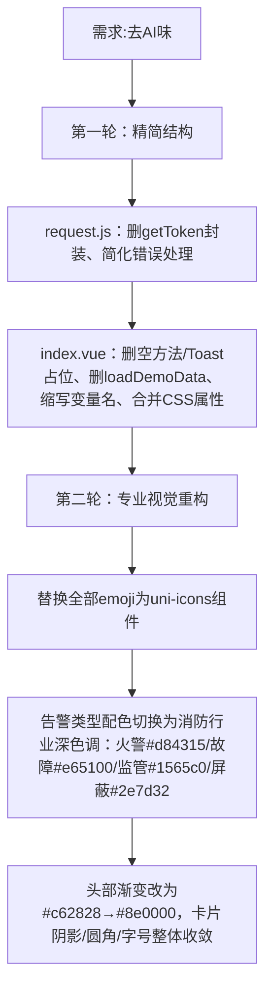

## 任务描述
为远程消防监控移动端首页（index.vue）及请求工具（request.js）去除AI生成风格，转向真实工程代码风格。

## 执行过程

## 任务总结
成功实现代码风格转型：request.js采用轻量Promise封装，index.vue使用uni-icons替代emoji、建立等级关联的标签配色体系、UI细节全面克制化，整体符合消防监控系统专业、稳重、可维护的工程规范。
